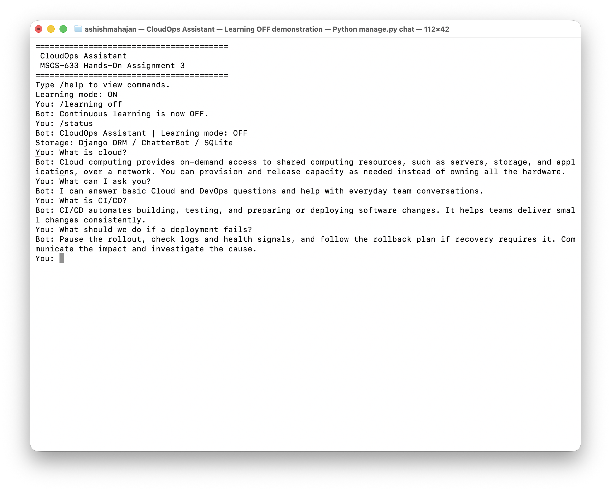
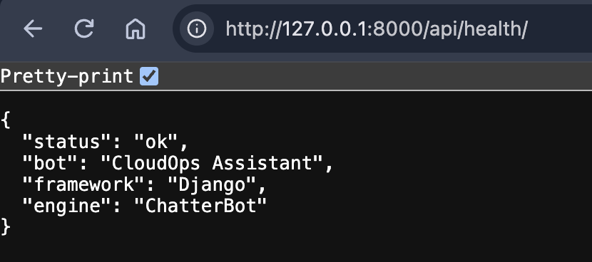

# MSCS633 Assignment 3: CloudOps Q&A Chatbot

## Overview

A Django/Python terminal chatbot built with ChatterBot for MSCS-633 Hands-On
Assignment 3. CloudOps Assistant answers Cloud/DevOps questions and supports
basic team conversation. Its primary interface is `python manage.py chat`.
ChatterBot learns associations from example conversations and retrieves replies
with its BestMatch adapter. This is example-based conversational training, not
an LLM or a neural model trained from scratch. No external AI API is used.

## Features

- Terminal conversation with help, status, clear, and graceful exits.
- General English conversation and custom Cloud/DevOps and team knowledge.
- Persistent SQLite storage through ChatterBot's Django ORM adapter.
- Continuous learning ON by default in the terminal, with an on/off toggle.
- Configurable confidence fallback for weak matches.
- Small CSRF-protected Django JSON API with learning always disabled.
- Automated tests using a separate Django test database.

## Technology Stack

| Component | Version / choice |
| --- | --- |
| Python | 3.11.15 validated; existing Python 3.11 chosen by the author |
| Django | 5.2.18 |
| ChatterBot | 1.2.15 |
| chatterbot-corpus | 1.3.3 |
| PyYAML | 6.0.3, needed to load and validate YAML corpora |
| Database | Django's SQLite database, `db.sqlite3` |
| Matching | Built-in BestMatch, lowercase indexing, string similarity |

The original brief recommended Python 3.12. The author explicitly selected the
existing Python 3.11 instead; this implementation was validated on 3.11.15.
ChatterBot installs spaCy transitively. Its built-in `LowercaseTagger` uses an
empty English pipeline, so no separate language-model download is needed.
SQLAlchemy is also an upstream dependency; this project stores data through Django.

## Project Structure

```text
manage.py                     Django command entry point
requirements.txt              Pinned direct dependencies
MANIFEST.in                   Source-distribution resource manifest
pyproject.toml                Minimal setuptools packaging metadata
smartchat/                    Settings, URLs, WSGI and ASGI
chatbot_app/
  bot_service.py              Shared bot construction, learning and fallback
  terminal.py                 Testable slash-command handling
  views.py, urls.py           Health and chat JSON endpoints
  management/commands/
    chat.py                  Terminal input/output loop
    train_bot.py             Transactional corpus training
  tests/                     Service, corpus, terminal and HTTP tests
data/cloud_devops.yml         Custom conversations and assignment example
docs/
  screenshots/               Real runtime screenshots for the submission
  report/                    Final Word report with screenshots and GitHub URL
```

## Prerequisites

Python 3.11, Git, and internet access for the initial dependency installation.
Training and chat then run locally without an external AI service.

## Installation

From the existing local repository:

```bash
cd "/Users/ashishmahajan/WorkSpace/MS_UC/Advance Artificial Intelligence/MSCS633_Assignment_3_CB"
python3.11 -m venv .venv
source .venv/bin/activate
python -m pip install -r requirements.txt
python manage.py migrate
python manage.py train_bot
```

For a fresh clone, start with:

```bash
git clone https://github.com/AshishM26/MSCS633_Assignment_3_CB.git
cd MSCS633_Assignment_3_CB
```

Then follow the virtual-environment, installation, migration and training steps.
`migrate` applies both Django and `django_chatterbot` migrations; a separate
`migrate django_chatterbot` is unnecessary. The database and virtual environment
are ignored by Git. Learning can retain entered text, so keep the database local.

## Run the Chatbot

```bash
source .venv/bin/activate
python manage.py chat
```

The startup banner identifies the course and bot and shows `Learning mode: ON`.
If no training data exists, the command explains how to train the bot.

## Terminal Commands

| Command | Behavior |
| --- | --- |
| `/help` | Display available commands |
| `/status` | Show bot name, learning mode and storage |
| `/learning on` | Enable learning for this terminal session |
| `/learning off` | Read-only matching against existing knowledge |
| `/clear` | Clear the display only; keep all data |
| `/quit`, `/exit` | Exit gracefully |
| Ctrl+C, Ctrl+D | Exit gracefully |

Empty input is ignored. Unknown commands receive guidance. Messages are limited
to 500 characters. Unexpected errors retain diagnostics and allow another input.

## Sample Conversation

These are observed responses, presented as text rather than a screenshot:

```text
You: What is CI/CD?
Bot: CI/CD automates building, testing, and preparing or deploying software changes. It helps teams deliver small changes consistently.
You: What should we do if a deployment fails?
Bot: Pause the rollout, check logs and health signals, and follow the rollback plan if recovery requires it. Communicate the impact and investigate the cause.
You: /learning off
Bot: Continuous learning is now OFF.
```

## Optional Django API

```bash
python manage.py runserver
```

`GET http://127.0.0.1:8000/api/health/` reports application liveness and bot metadata
and sets a CSRF cookie. It is not a database or training-readiness check.
`POST /api/chat/` accepts `{"message": "What is CI/CD?"}` and returns the message,
response, similarity confidence, and `learning_enabled: false`.

Keep the server running and execute this standard-library example in a second
activated terminal. It preserves the cookie and supplies the CSRF header:

```bash
python - <<'PY'
import http.cookiejar
import json
import urllib.request

cookies = http.cookiejar.CookieJar()
client = urllib.request.build_opener(
    urllib.request.HTTPCookieProcessor(cookies)
)
base = "http://127.0.0.1:8000/api/"
with client.open(base + "health/") as response:
    print(response.read().decode())
token = next(c.value for c in cookies if c.name == "csrftoken")
request = urllib.request.Request(
    base + "chat/",
    data=json.dumps({"message": "What is CI/CD?"}).encode(),
    headers={"Content-Type": "application/json", "X-CSRFToken": token},
)
with client.open(request) as response:
    print(response.read().decode())
PY
```

There is no CSRF exemption. Missing/invalid tokens receive 403; malformed JSON or
invalid messages receive 400; unsupported methods receive 405; oversized bodies
receive 413; non-JSON content receives 415; runtime failures receive 503. Method
errors use Django's standard response rather than a custom JSON body. POST input
validation assumes a valid CSRF token.

Each request uses the shared service configuration and persistent knowledge but
an independent read-only instance. Terminal learning cannot enable API learning.
No API option enables it. This local educational server allows loopback hosts
and disables debug pages; it is not a production service.

## Training Data

`python manage.py train_bot` trains exactly:

1. `chatterbot.corpus.english.greetings`
2. `chatterbot.corpus.english.conversations`
3. `data/cloud_devops.yml`

The custom file has **63 two-line Q&A conversations plus one four-line assignment
example**, totaling 64 conversations. This exceeds the suggested 35–40 pairs to
cover every requested topic, capability questions, cloud basics, and natural
paraphrases. Topics include general chat,
standups, incidents, deployments, infrastructure, observability, RTO and RPO.
Standard corpus greetings have several valid responses; exact wording can vary.

Training is transactional and never intentionally deletes learned rows.
ChatterBot 1.2.15's Django adapter **inserts duplicate statements on repeated
training**. Repeat runs are supported but not idempotent; tests verify this.
Train once for normal setup, and repeat as needed after corpus edits.

## Continuous Learning

ON uses ChatterBot's normal `read_only=False` behavior: accepted inputs and
responses are saved in SQLite. Later inputs are associated with earlier
conversation turns. This is example collection, not fact checking or an LLM
fine-tune; saving a statement does not guarantee a useful learned answer.

OFF sets `read_only=True` on the existing instance, preserving trained knowledge
and preventing new chat writes. Toggling never erases the database. New terminal
sessions start ON; API requests always start OFF.

`BOT_MIN_CONFIDENCE` in `smartchat/settings.py` is **0.90**. Validation found that
0.75 allowed "What is pizza?" to match IAM with a score of 0.85. The conservative
threshold rejects this example. Weak-response writes are rolled back before
displaying fallback, so rejected answers are not learned. Trained questions and
the supplied paraphrases remain available.

Confidence measures string similarity, not factual accuracy or semantic
understanding. Unseen wording may be rejected, and similarly spelled topics can
still be confused. Add reviewed corpus examples for reliable new topics.
`BOT_NAME` centralizes the name; the service reapplies it because ChatterBot
1.2.15's Django startup overwrites its own name setting.

## Testing

```bash
python --version
python -m chatterbot --version
python -m django --version
python -m pip check
python manage.py check
python manage.py test -v 2
```

Tests use Django's isolated in-memory SQLite database. Most train tiny examples;
corpus acceptance tests also check every custom question, repeat training, and
unrelated inputs. Tests verify actual persistence changes, CSRF, validation,
error handling, and terminal exits. Run the commands above to reproduce the
checks. Local working notes and generated validation records are excluded from
version control and source distributions.

## Screenshots

The author supplied these real application screenshots, stored in
`docs/screenshots/` without modifying their content. The terminal capture shows
learning switched OFF while trained answers remain available.





For a terminal screenshot, use a wide window and enter these lines one at a time:

```text
Good morning!
What is CI/CD?
What should we do if a deployment fails?
What is Kubernetes?
/learning off
/status
```

For a new capture, include the banner, answers and OFF status before `/exit`.
Both screenshots are embedded in the
[final Word report](docs/report/MSCS633_Assignment_3_Report.docx), together with
the implementation summary, GitHub URL, and validation results.

## Assignment Deliverables

| Required item | Artifact |
| --- | --- |
| Python source | `manage.py`, `smartchat/`, `chatbot_app/` |
| Manifest | `requirements.txt` and `MANIFEST.in` |
| Training knowledge | Custom YAML and two selected English corpora |
| Working runtime | Terminal and Django API; reproducible checks above |
| Screenshot in Word | `docs/report/MSCS633_Assignment_3_Report.docx` includes both real captures |
| GitHub URL | Included in the Word report and below |

Upload the Word report, `MANIFEST.in`, and `requirements.txt` for submission.
The report links to this repository for the Python source and setup instructions.

`MANIFEST.in` uses real setuptools source-distribution directives, enabled by
`pyproject.toml`. Run from the checkout or extracted source archive so `data/`
stays beside `manage.py`. A standalone installed wheel is not a supported workflow.

## GitHub Repository

https://github.com/AshishM26/MSCS633_Assignment_3_CB

## Author

Ashish Bhanudas Mahajan

## Course

MSCS-633 Advanced Artificial Intelligence
University of the Cumberlands

## References and Learning Notes

- [ChatterBot Django integration](https://docs.chatterbot.us/django/): app and ORM integration.
- [ChatterBot response and persistence source](https://docs.chatterbot.us/_modules/chatterbot/chatterbot/): read-only behavior.
- [Built-in taggers](https://docs.chatterbot.us/_modules/chatterbot/tagging/): lowercase indexing without a downloaded model.
- [Django CSRF guidance](https://docs.djangoproject.com/en/5.2/howto/csrf/): cookies and request headers.

For class, trace one question through the management command, BotService,
ChatterBot BestMatch, and Django SQLite. Explain why disabling learning changes
writes but preserves answers. Why is similarity confidence not factual certainty?
